# FreezerGuard — Manual de Uso de la Aplicación Web

**Sistema Integral de Monitoreo Térmico, Detección de Fallas Energéticas y Gestión de Muestras de Laboratorio**  
*Proyecto Final de Grado — Tecnólogo Informático*  
**Institución:** Universidad Tecnológica (UTEC) • Sede Paysandú, Uruguay (en conjunto con UDELAR y DGETP-UTU)  
**Autores:** Carlos Cardozo, Jhon Guimaraens, Matías Parente  
**Tutores:** Sonia Rocha, Marcelo Scotto  

---

## Tabla de Contenidos
1. [Introducción y Conceptos Clave](#1-introducción-y-conceptos-clave)
2. [Roles y Permisos de Usuario](#2-roles-y-permisos-de-usuario)
3. [Inicio de Sesión (Login)](#3-inicio-de-sesión-login)
4. [Panel de Control Principal (Dashboard / Resumen)](#4-panel-de-control-principal-dashboard--resumen)
   - 4.1 [Barra Lateral de Navegación](#41-barra-lateral-de-navegación)
   - 4.2 [Selector Global de Dispositivo](#42-selector-global-de-dispositivo)
   - 4.3 [Tarjetas Métricas Superiores (Top Metric Cards)](#43-tarjetas-métricas-superiores-top-metric-cards)
   - 4.4 [Gráfico de Monitoreo en Tiempo Real](#44-gráfico-de-monitoreo-en-tiempo-real)
   - 4.5 [Acordeón de Muestras por Vencer](#45-acordeón-de-muestras-por-vencer)
   - 4.6 [Acordeón de Alertas Recientes](#46-acordeón-de-alertas-recientes)
5. [Historial de Mediciones](#5-historial-de-mediciones)
6. [Gestión de Muestras Almacenadas](#6-gestión-de-muestras-almacenadas)
   - 6.1 [Indicador Visual de Riesgo en Freezer](#61-indicador-visual-de-riesgo-en-freezer)
   - 6.2 [Fila Expandible: Docentes y Alumnos](#62-fila-expandible-docentes-y-alumnos)
   - 6.3 [Alta y Modificación de Muestras](#63-alta-y-modificación-de-muestras)
   - 6.4 [Inhabilitación, Historial y Restauración](#64-inhabilitación-historial-y-restauración)
7. [Centro de Alertas Generadas](#7-centro-de-alertas-generadas)
   - 7.1 [Estados de Alerta: Pendiente vs Resuelta](#71-estados-de-alerta-pendiente-vs-resuelta)
   - 7.2 [Fila Expandible: Muestras Afectadas y Duración](#72-fila-expandible-muestras-afectadas-y-duración)
   - 7.3 [Bitácora de Observaciones](#73-bitácora-de-observaciones)
   - 7.4 [Resolución Remota vía Correo Electrónico](#74-resolución-remota-vía-correo-electrónico)
8. [Gestión de Usuarios (Administrador General)](#8-gestión-de-usuarios-administrador-general)
   - 8.1 [Creación de Usuarios](#81-creación-de-usuarios)
   - 8.2 [Asignación de Rol Administrador General](#82-asignación-de-rol-administrador-general)
   - 8.3 [Restablecimiento de Contraseñas](#83-restablecimiento-de-contraseñas)
   - 8.4 [Baja Lógica y Eliminación Definitiva](#84-baja-lógica-y-eliminación-definitiva)
9. [Sedes y Laboratorios (Administrador General)](#9-sedes-y-laboratorios-administrador-general)
   - 9.1 [Estructura: Sedes y Laboratorios](#91-estructura-sedes-y-laboratorios)
   - 9.2 [Asignación de Freezers a Laboratorios](#92-asignación-de-freezers-a-laboratorios)
   - 9.3 [Participantes de Muestras](#93-participantes-de-muestras)
   - 9.4 [Notificaciones por Correo](#94-notificaciones-por-correo)
10. [Configuración de Dispositivos y Notificaciones (Administrador General)](#10-configuración-de-dispositivos-y-notificaciones-administrador-general)
   - 10.1 [Dispositivos Hardware (ESP32)](#101-dispositivos-hardware-esp32)
   - 10.2 [Parámetros Globales del Sistema](#102-parámetros-globales-del-sistema)
   - 10.3 [Canales de Despacho: Email y SMS con Prueba GSM](#103-canales-de-despacho-email-y-sms-con-prueba-gsm)
11. [Perfil de Usuario y Sesión](#11-perfil-de-usuario-y-sesión)
12. [Glosario Visual de Botones e Iconos](#12-glosario-visual-de-botones-e-iconos)
13. [Protocolo de Contingencia ante Incidentes Reales](#13-protocolo-de-contingencia-ante-incidentes-reales)

---

## 1. Introducción y Conceptos Clave

**FreezerGuard** es una solución diseñada para preservar la integridad de muestras biológicas y químicas en laboratorios académicos y de investigación. El sistema supervisa continuamente variables ambientales y eléctricas críticas mediante dispositivos electrónicos de campo (ESP32) instalados en los freezers, transmitiendo telemetría en tiempo real a esta plataforma web mediante protocolos seguros.

```
  +--------------------+     WiFi/HTTP Request   +---------------------+
  |   Freezer Físico   | ----------------------> |   Servidor Web      |
  |  - Sensor Temp.    |                         |   - Laravel Backend |
  |  - Sensor Red 220V |        Alerta SMS       |   - PostgreSQL/MySQL|
  |  - Módem SIM800L   | ------------+           |   - React + Inertia |
  +--------------------+             |           +----------+----------+
                                     v                      |
                             Teléfono Móvil                 v
                              (Guardia SMS)        Navegador Web Usuario
                                                    (Alertas por Email)
```

### ¿Qué protege la plataforma?
* **Pérdida de frío:** Detección de temperatura fuera de los rangos biológicos admitidos por cada reactivo o muestra.
* **Corte del suministro eléctrico:** Detección inmediata de interrupción de energía comercial (220V) antes de que la temperatura interna comience a elevarse.
* **Pérdida de conectividad:** Alertas de inactividad si el equipo de campo pierde señal de red.
* **Vencimiento de muestras:** Monitoreo preventivo de reactivos próximos a caducar.

---

## 2. Roles y Permisos de Usuario

La plataforma distingue dos niveles de acceso para garantizar la seguridad del laboratorio:

| Nivel | Rol en la Web | Permisos Principales |
|---|---|---|
| **Docente** | *Usuario Estándar* | Visualizar el Dashboard en tiempo real, filtrar y consultar el historial de mediciones, registrar y editar muestras de su autoría o laboratorio, ver alertas activas y añadir observaciones de resolución. |
| **Encargado de Laboratorio / Soporte** | *Admin General* | Todos los permisos de usuario estándar, más: Crear y dar de baja usuarios, promover administradores, resetear claves, vincular nuevos módulos ESP32, modificar umbrales de telemetría, teléfonos de guardia SMS y plantillas de correo. |

---

## 3. Inicio de Sesión (Login)

Para ingresar al sistema, dirígete en tu navegador a la ruta **/login** (por ejemplo: `https://freezerguard.tudominio.com/login` o `http://127.0.0.1:8000/login`).


### Elementos y Controles de la Pantalla:
1. **Campo `Correo Electrónico`:** Ingresa la cuenta de correo institucional con la que fuiste dado de alta (ejemplo: `docente@utec.edu.uy`).
2. **Campo `Contraseña`:** Clave personal asignada por el Administrador General o modificada en tu perfil.
3. **Casilla `Recordarme`:** Marca esta casilla si estás utilizando un equipo de trabajo habitual para evitar que la sesión caduque automáticamente al cerrar la ventana.
4. **Botón `INICIAR SESIÓN`:** Botón principal de color índigo. Valida las credenciales ante la base de datos y te redirige inmediatamente al **Panel de Control Principal (Dashboard)**.

> **Nota:** Si ingresas una contraseña incorrecta o un correo no registrado, el sistema resaltará el campo en rojo indicando el error. Contacta a un *Administrador General* si no recuerdas tu clave para que proceda con un reseteo directo.

---

## 4. Panel de Control Principal (Dashboard / Resumen)

Al autenticarte, accederás a la vista general del sistema. Esta pantalla centraliza el estado térmico, energético y operativo de los freezers vinculados.

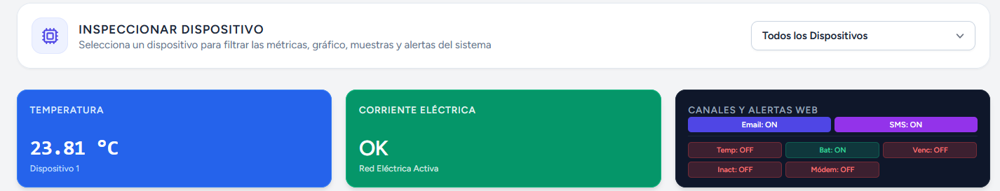

### 4.1 Barra Lateral de Navegación
Ubicada a la izquierda de la pantalla (o accesible mediante el menú en dispositivos móviles):
* **Resumen (`Dashboard`):** Vista de cabecera con métricas instantáneas, gráfico y alertas.
* **Alertas:** Registro completo de eventos e incidentes con filtro de estado (con indicador numérico en rojo si existen alertas pendientes).
* **Mediciones:** Base de datos histórica con lecturas tabuladas de cada dispositivo.
* **Muestras:** Catálogo de muestras almacenadas, sus rangos térmicos y responsables.
* **Configuración:** *(Visible solo para Administradores)* Ajustes del sistema y de hardware.
* **Usuarios:** *(Visible solo para Administradores)* Administración de cuentas de usuario.
* **Perfil:** Actualización de datos personales y cambio de contraseña.
* **Cerrar Sesión:** Cierra de forma segura la sesión activa del usuario.

### 4.2 Selector Global de Dispositivo
En la parte superior derecha del área de trabajo encontrarás el selector desplegable:
* **Dropdown `Todos los Dispositivos`:** Permite seleccionar un freezer o placa específica (ej. *ESP32 Lab Central*). Al seleccionarlo, **todas las tarjetas métricas, el gráfico, las muestras y las alertas se filtran automáticamente** para mostrar únicamente la información correspondiente a dicho equipo.

---

### 4.3 Tarjetas Métricas Superiores
Estas tres tarjetas ofrecen un diagnóstico inmediato en menos de 3 segundos:


#### 1. Tarjeta `Temperatura`
* **Valor numérico grande:** Indica la última temperatura reportada por el sensor en grados Celsius (con dos decimales, ej. `-21.40 °C`).
* **Pie de tarjeta:** Informa el nombre del dispositivo emisor y el estado de rango térmico.
* **Frecuencia:** Se actualiza silenciosamente en segundo plano cada 4 segundos.

#### 2. Tarjeta `Corriente Eléctrica`
* **Estado Verde (`OK - Red Eléctrica Activa`):** Significa que el freezer recibe alimentación eléctrica con normalidad.
* **Estado Rojo (`Batería - Corte de Luz detectado`):** Es una alerta. El suministro eléctrico de la red se ha interrumpido. El dispositivo de campo está funcionando con su batería de respaldo recargable y el freezer ha dejado de enfriar.

#### 3. Tarjeta `Canales y Alertas Web`
* **Indicadores de Canales:** Badges `Email: ON/OFF` y `SMS: ON/OFF` que muestran si los servicios de envío masivo están activos globalmente.
* **Disparadores de Alerta:** Muestra en verde los tipos de alertas vigiladas: `Temp` (temperatura), `Bat` (corte de luz/batería), `Venc` (vencimiento de muestra), `Inact` (falta de comunicación) y `GSM` (módem celular).
* **Punto de Alerta:** Si parpadea en color rojo, indica que existen alertas pendientes sin resolver en el laboratorio.

---

### 4.4 Gráfico de Monitoreo en Tiempo Real
Permite examinar la curva térmica de los freezers con actualización continua.

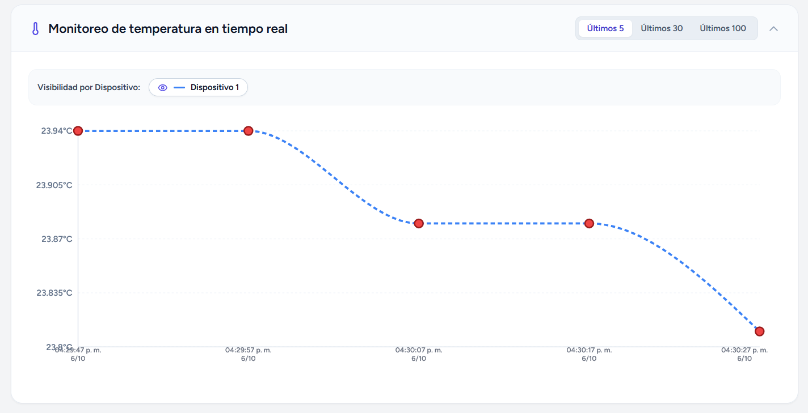

#### Controles del Gráfico:
* **Botón Acordeón (`ChevronUp / ChevronDown`):** Permite plegar o desplegar la sección del gráfico para ahorrar espacio visual.
* **Selectores de Rango Temporal (`Últimos 5`, `Últimos 30`, `Últimos 100`):**
  * `Últimos 5`: Vista de alta resolución inmediata de las mediciones más recientes.
  * `Últimos 30`: Tendencia térmica de los ultimos 30 registros.
  * `Últimos 100`: Panorama extendido para verificar estabilidad en ciclos de refrigeración prolongados.
* **Visibilidad por Dispositivo:**
  * Botón con **ojo abierto (`Eye`)** y línea punteada de color: La curva térmica del equipo está visible en la gráfica.
  * Botón con **ojo tachado (`EyeOff`)** y texto tachado: Oculta temporalmente la curva de ese dispositivo para facilitar la lectura de otros freezers.
* **Puntos Interactivos:** Al posar el cursor o dedo sobre cualquier punto de la línea, se muestra una ventana flotante con la hora exacta, fecha, temperatura precisa y si el punto disparó alguna alerta.

---

### 4.5 Acordeón de Muestras por Vencer
Presenta de manera compacta las muestras de laboratorio almacenadas según su proximidad a la fecha de caducidad.

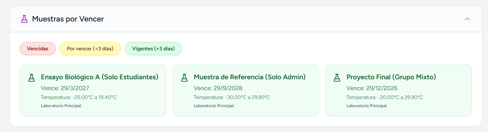

* **Filtros por Estado:**
  * `Vencidas` (Rojo): Muestras cuya fecha de caducidad ya ha sido superada.
  * `Por vencer (<3 días)` (Amarillo): Muestras que expirarán en las próximas 72 horas.
  * `Vigentes (+3 días)` (Verde): Muestras en perfecto estado de conservación temporal.
* **Tarjetas de Muestra:** Muestran el nombre del reactivo, días restantes, límites térmicos admitidos (ej: `-25.0°C a -18.0°C`) y el freezer donde se encuentran físicamente.

---

### 4.6 Alertas Recientes
Muestra los últimos eventos generados en el sistema:
* **Insignia `X sin resolver`:** Indica la cantidad de incidencias abiertas que requieren atención humana.
* **Insignia `Todas resueltas`:** Confirma que el laboratorio se encuentra en condiciones nominales.
* **Paginación:** Permite hojear las alertas históricas sin abandonar la pantalla principal.

---

## 5. Historial de Mediciones

Ubicado en la ruta **/mediciones**, este módulo funciona como la bitácora de auditoría térmica y energética de todos los dispositivos.

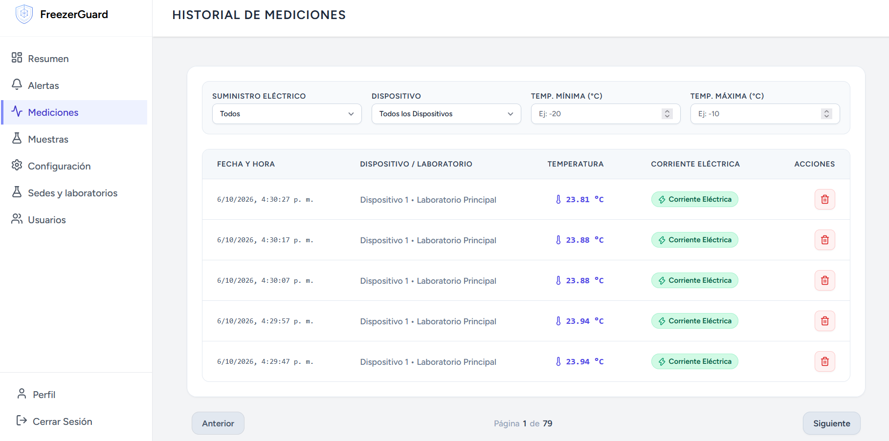

### Barra de Filtros:
1. **`Suministro Eléctrico`:** Filtra las filas según la fuente de energía:
   * *Todos:* Muestra la totalidad de lecturas.
   * *En Batería (Corte de Luz):* Muestra exclusivamente los períodos en los que el freezer operó sin electricidad de red comercial.
   * *Corriente Eléctrica:* Muestra las lecturas con suministro normal 220V.
2. **`Dispositivo`:** Selecciona el equipo de campo o laboratorio a inspeccionar.
3. **`Temp. Mínima (°C)` y `Temp. Máxima (°C)`:** Permite ingresar valores numéricos para auditar excursiones térmicas (por ejemplo, buscar lecturas que hayan superado los `-15.0 °C`).
4. **Paginación:** Permite desplazarse cómodamente entre cientos de registros históricos guardados.

### Acciones en la Tabla:
* **Botón `Eliminar` (Tacho Rojo):** Permite borrar de forma permanente registros anómalos o lecturas generadas durante pruebas de calibración en banco de trabajo. Al pulsarlo, el sistema solicitará confirmación antes de aplicar el borrado.

---

## 6. Gestión de Muestras Almacenadas

Accesible desde **/muestras**, es el catálogo de todo el material biológico, químico y reactivos custodiados en los freezers.

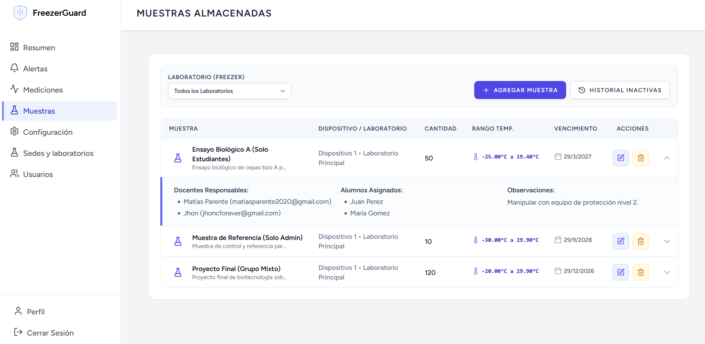

### 6.1 Indicador Visual de Riesgo en Freezer
Si un freezer experimenta una falla térmica o un corte de energía, todas las muestras almacenadas en ese equipo se resaltarán automáticamente con fondo rojizo y un ícono de advertencia pulsante. Esto permite al personal identificar al instante qué material debe ser reubicado con urgencia.

### 6.2 Fila Expandible: Docentes y Alumnos
Al hacer clic en cualquier fila de la tabla, se expande un panel inferior detallado:
* **Docentes Responsables:** Nombre y correo electrónico de los profesores o investigadores principales a quienes el sistema envía alertas automáticas.
* **Alumnos Asignados:** Estudiantes a cargo de los experimentos/muestras.
* **Observaciones:** Notas editables (ej. "No descongelar ni agitar").

### 6.3 Alta y Modificación de Muestras
* **Botón `AGREGAR MUESTRA`:** Abre el formulario modal para ingresar:
  * *Nombre y Cantidad:* (ej. "Insulina Recombinante", "24 viales").
  * *Descripción:* Descripción detallada.
  * *Rango de Temperatura Permitido:* Define el umbral mínimo y máximo (ej. `-25.0 °C` a `-10.0 °C`). El sistema utilizará estos valores para disparar alertas si el sensor detecta una anomalía.
  * *Ubicación (Freezer):* Freezer físico asignado.
  * *Fecha de vencimiento:* Asignar una fecha de vencimieinto a la muestra para alertar en caso de vencimiento.
  * *Docentes Responsables:* Lista de casillas de verificación para marcar a qué docentes se les enviará notificación vía correo electrónico ante cualquier eventualidad.
  * *Alumnos asignados:* Para asignar alumnos a las muestras pero no se les envía notificaciones en caso de alertas.  
  * *Observaciones:* Notas editables sobre la muestra.
* **Botón `Modificar Muestra`:** Abre el mismo formulario con los datos precargados para actualizar cantidades, rangos o docentes a cargo.

### 6.4 Inhabilitación, Historial y Restauración
Para preservar la trazabilidad científica de las investigaciones, las muestras no se borran por accidente:
* **Botón `Inhabilitar muestra`:** Realiza una baja lógica (*Soft Delete*). La muestra deja de figurar en el listado activo pero sus datos históricos no se pierden.
* **Botón `HISTORIAL INACTIVAS`:** Alterna la vista para consultar todas las muestras que han sido consumidas o dadas de baja.
* **Botón `Restaurar muestra`:** Reactiva inmediatamente la muestra en el catálogo principal.
* **Botón `Eliminar definitivamente`:** Elimina permanentemente el registro de la base de datos tras confirmación del operador.

---

## 7. Centro de Alertas Generadas

Accesible desde **/alertas**, constituye el centro neurálgico de incidentes de la plataforma.

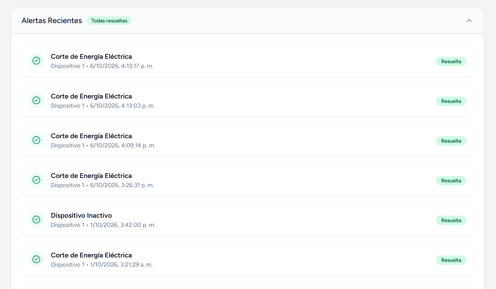

### 7.1 Estados de Alerta: Pendiente vs Resuelta
* **Icono Rojo `Pendiente`:** El problema persiste o aún no ha sido verificado por un operador.
* **Icono Verde `Resuelta`:** La contingencia fue solucionada. Muestra la fecha y hora exacta en que se normalizó la variable o se cerró la incidencia.

### 7.2 Fila Expandible: Muestras Afectadas y Duración
Al hacer clic en cualquier fila de alerta:
* **Muestras Afectadas:** Detalla qué lotes biológicos sufrieron el desvío térmico y quiénes son los docentes responsables para contacto inmediato.
* **Duración del Evento:** Calcula automáticamente el tiempo que duró la contingencia (ej. *"45 min"*, *"2h 10m"*) o muestra *"En progreso..."* si la variable aún no regresó a la normalidad.
* **Temp. Origen:** Temperatura exacta del sensor en el instante en que se disparó la alarma (ej. `-8.40 °C`).
* **Bitácora / Observación:** Historial de comentarios técnicos cargados por el personal.

### 7.3 Bitácora de Observaciones
* **Botón `Editar Observación`:** Abre un modal para redactar las acciones correctivas tomadas (por ejemplo: *"Se cerró la puerta que había quedado mal encajada por el turno matutino"*).
* **Botón `Eliminar Alerta`:** Remueve el registro de alerta de la base de datos.

### 7.4 Resolución Remota vía Correo Electrónico
Cuando se produce una alerta crítica, el sistema despacha correos automáticos a los docentes asignados (ya sea por la muestra o por la pagina de configuración). Dicho correo incluye un enlace seguro que al presionarlo desde cualquier teléfono móvil o computadora:
1. La alerta se marca instantáneamente como **Resuelta**.
2. Queda registrado en la bitácora: *"Resuelto manualmente por el usuario a través de correo electrónico"*.
3. No es necesario recordar ni ingresar contraseñas para validar la resolución en situaciones de emergencia.

---

## 8. Gestión de Usuarios (Administrador General)

Accesible únicamente para usuarios con permisos directivos o de administración general desde **/usuarios**.

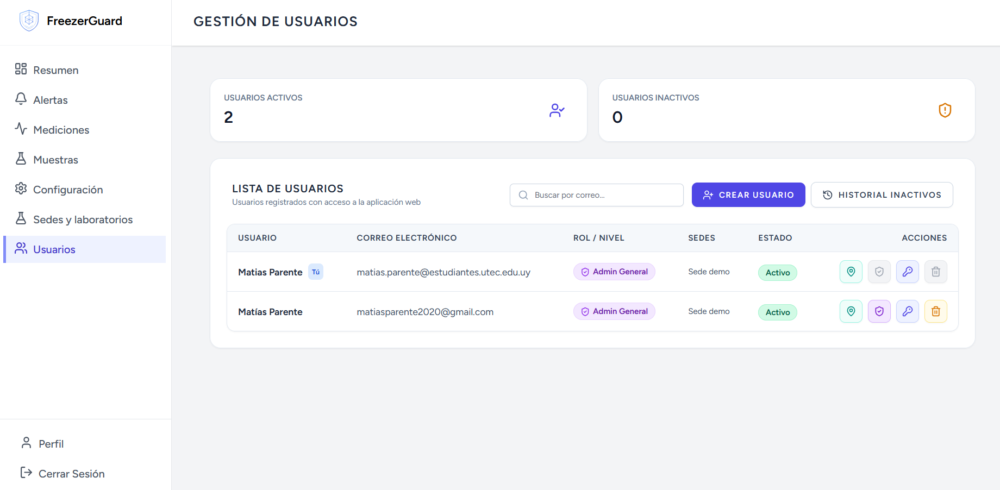

### 8.1 Creación de Usuarios
* **Botón `CREAR USUARIO`:** Despliega un formulario modal donde se ingresan:
  * Nombre y Apellido.
  * Correo Electrónico institucional.
  * Contraseña inicial y confirmación.
  * Casilla opcional: *¿Es Administrador General?* (para otorgar privilegios totales).

### 8.2 Asignación de Rol Administrador General
* **Botón `Alternar Admin General`:** Otorga o retira el rango de Administrador General a cualquier usuario.
* *Seguridad:* El botón aparece deshabilitado en tu propia fila de usuario para evitar que un administrador se bloquee a sí mismo accidentalmente.

### 8.3 Restablecimiento de Contraseñas
* **Botón `Resetear Contraseña`:** Permite al administrador asignar una nueva clave a un docente o alumno que haya olvidado sus credenciales, restableciendo su acceso.

### 8.4 Baja Lógica y Eliminación Definitiva
* **Botón `Desactivar usuario`:** Suspende temporalmente el acceso del usuario a la plataforma sin borrar las muestras ni el historial asociado a su nombre.
* **Modo `HISTORIAL INACTIVOS`:** Permite examinar usuarios dados de baja, reactivarlos con el botón `Restaurar` o borrarlos permanentemente con el botón `Eliminar definitivamente`.

---

## 9. Sedes y Laboratorios (Administrador General)

Accesible desde **/sedes**, este módulo permite organizar la estructura física del centro en sedes y laboratorios, asignar freezers a laboratorios y gestionar participantes de muestras.

La pantalla presenta tres tarjetas métricas superiores con la cantidad total de sedes, laboratorios y personas asignadas. Debajo, dos pestañas permiten alternar entre la vista de **Estructura** y la de **Participantes**.

### 9.1 Estructura: Sedes y Laboratorios

La pestaña **Estructura** muestra una guía de pasos y la jerarquía organizacional:

#### Crear una Sede
* **Botón `Nueva Sede`:** Despliega un formulario donde se ingresa el nombre de la sede (ej. *"Sede Paysandú"*, *"Sede Montevideo"*).
* Una vez creada, la sede aparece en la lista con sus laboratorios, personas asignadas e indicadores de cantidad.

#### Crear un Laboratorio
* **Botón `Nuevo Laboratorio`:** Despliega un formulario donde se selecciona la sede a la que pertenece y se ingresa el nombre (ej. *"Lab Biología Molecular"*, *"Lab Química Analítica"*).
* Los laboratorios se muestran anidados dentro de su sede correspondiente.

#### Renombrar y Eliminar
* **Botón lápiz:** Permite renombrar una sede o laboratorio existente.
* **Botón eliminar (tacho rojo):** Elimina la sede o laboratorio. Solo es posible si no tiene laboratorios, freezers o personas asignadas respectivamente.

### 9.2 Asignación de Freezers a Laboratorios

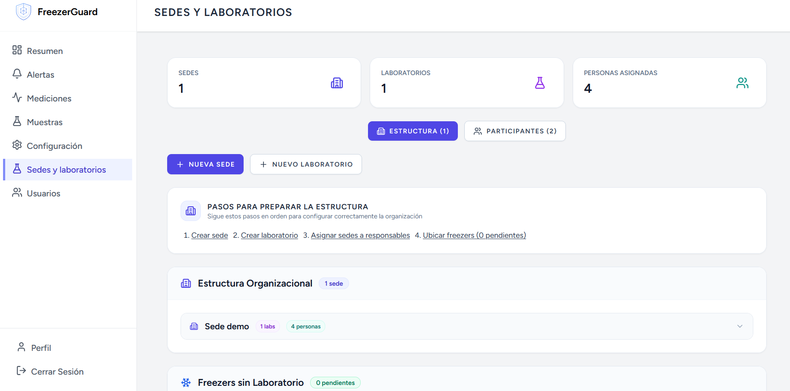

En la sección inferior de la pestaña Estructura se muestra la lista de **Freezers sin Laboratorio** (pendientes de asignación). Para cada freezer:
* Selecciona el laboratorio de destino del desplegable (organizado como *"Sede / Laboratorio"*).
* Presiona **Asignar** para vincular el freezer al laboratorio.
* Un freezer ya asignado puede ser movido a otro laboratorio con el botón **Mover**.

> **Nota:** No se permite asignar un freezer a un laboratorio de otra sede si ya tiene responsables o participantes de muestras que no pertenecen a esa sede.

### 9.3 Participantes de Muestras

La pestaña **Participantes** permite gestionar a los alumnos y colaboradores que participan de muestras pero no tienen cuenta de acceso al sistema.

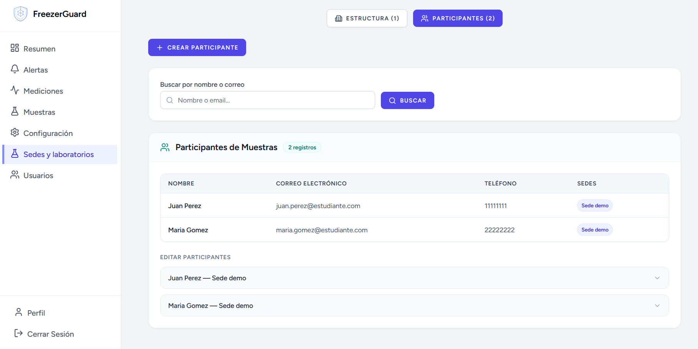

* **Botón `Crear Participante`:** Despliega un formulario con:
  * Nombre completo.
  * Correo electrónico.
  * Teléfono (opcional).
  * Sedes a las que pertenece (una o más).
* **Buscador:** Permite filtrar participantes por nombre o correo electrónico.
* **Tabla de participantes:** Muestra nombre, correo, teléfono y las sedes asignadas con badges de color.
* **Edición:** Cada participante puede expandirse para modificar sus datos o cambiar sus sedes.


---

## 10. Configuración de Dispositivos y Notificaciones (Administrador General)

Ubicado en **/configuracion**, este módulo permite vincular el hardware IoT con la plataforma web y definir las políticas globales de alerta.

### 10.1 Dispositivos Hardware (ESP32)

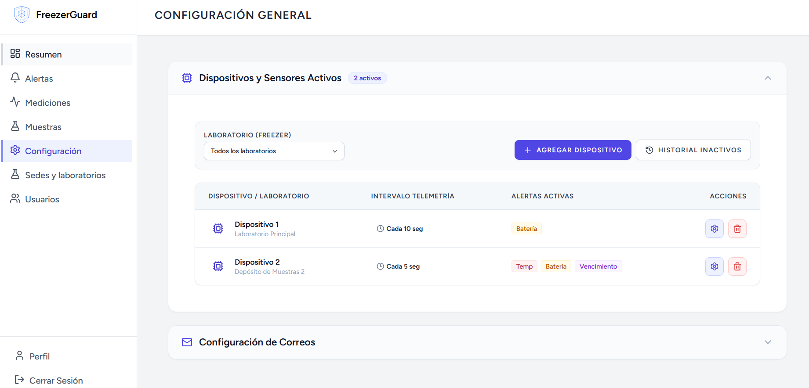

* **Botón `AGREGAR DISPOSITIVO`:** Permite registrar una nueva placa ESP32 y asociarla a un freezer existente o crear una nueva ubicación física de laboratorio (ej. *"Lab Biología Molecular - Freezer 3"*).

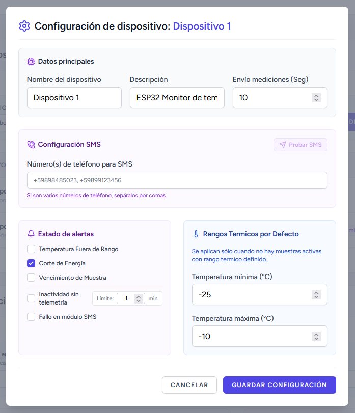

* **Botón `Configurar Dispositivo`:** Despliega el modal de ajuste fino del microcontrolador:
  1. **Envío de Telemetría (Segundos):** Frecuencia con la que el ESP32 transmite datos vía WiFi/MQTT (por defecto: `5 segundos`).
  2. **Números de Teléfono para SMS:** Números móviles de guardia (ej: `+59898485023, +59899123456`) que recibirán mensajes de texto urgentes si falla la red o sube la temperatura.
  3. **Disparadores de Alerta:**
     * *Temperatura Fuera de Rango:* Alerta ante variaciones en los límites de temperatura.
     * *Corte de Energía:* Alerta al caer la red eléctrica.
     * *Vencimiento de Muestra:* Aviso automático de muestras caducadas.
     * *Inactividad sin telemetría:* Alerta si se dejan de recibir datos del dispositivo durante un tiempo determinado (ajustable de 1 a 10080 minutos, ej. `30 min`).
     * *Fallo en módulo SMS:* Detección de pérdida de cobertura de la tarjeta SIM celular.
  4. **Rangos Térmicos por Defecto:** Valores de seguridad (ej. `-25.0 °C` a `-10.0 °C`) que aplican al freezer cuando no contiene muestras activas con requerimientos térmicos específicos.

---

### 10.2 Parámetros Globales del Sistema

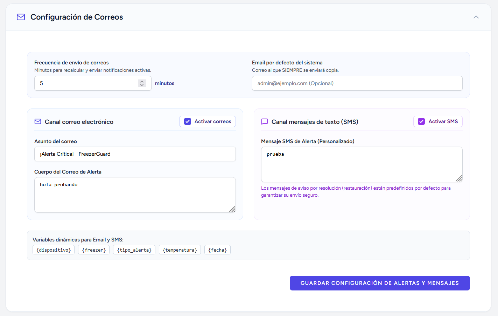

* **Frecuencia de Envío de Correos:** Intervalo en minutos en el que el servidor recalcula y reenvía recordatorios de contingencias no resueltas (ej. cada `1 minuto`).
* **Email por Defecto del Sistema:** Casilla de correo institucional que recibe copia de auditoría de todas las incidencias registradas en el centro.

---

### 10.3 Canales de Despacho: Email y SMS con Prueba GSM
* **Canal Correo Electrónico:**
  * Casilla de activación global `Activar correos`.
  * *Asunto del correo y Plantilla del cuerpo:* Personalizables para incluir datos dinámicos.
* **Canal Mensajes de Texto (SMS):**
  * Casilla de activación `Activar SMS`.
  * **Botón `PROBAR SMS`:** Ubicado dentro de la configuración de cada dispositivo individual (junto al campo de número de teléfono SMS), envía una orden a la placa ESP32 para que despache un SMS de prueba al número configurado en ese dispositivo. Es fundamental para comprobar que el módulo SIM800L, la antena y el saldo de la tarjeta SIM operan correctamente antes de dejar el freezer en producción.
* **Variables Dinámicas Disponibles en Plantillas:**
  * `{dispositivo}`: Nombre del ESP32 emisor.
  * `{freezer}`: Nombre o ubicación del freezer afectado.
  * `{tipo_alerta}`: Descripción de la falla detectada.
  * `{temperatura}`: Valor térmico medido en el momento del evento.
  * `{fecha}`: Fecha y hora exacta de la incidencia.

---

### 11 Notificaciones por Correo

El sistema envía notificaciones automáticas por correo electrónico en los siguientes eventos:

* **Asignación a Sede:** Cuando un administrador asigna un usuario a una o más sedes (ya sea al crear el usuario o al modificar sus sedes), el usuario recibe un correo informándole las sedes a las que fue asignado.
* **Asignación a Muestra:** Cuando un docente es asignado como responsable de una muestra (al crear o editar una muestra), recibe un correo con los detalles de la muestra: título, freezer, rango térmico y fecha de vencimiento.
* **Creación de Usuario:** Cuando se crea un usuario, se envía un correo con sus credenciales de acceso.
* **Restablecimiento de Contraseña:** Cuando un usuario restablece su contraseña, recibe un correo con su nueva contraseña.
* **Eliminar usuario:** Cuando un usuario es eliminado, recibe un correo informándole que su cuenta ha sido eliminada.
* **Restaurar usuario:** Cuando un usuario es restaurado, recibe un correo informándole que su cuenta ha sido restaurada.
* **Resolución de Alertas:** Cuando un usuario resuelve una alerta, recibe un correo informándole que la alerta ha sido resuelta.
* **Envio de alertas:** Cuando ocurre una alerta, se envia automaticamente un correo electronico informando sobre la misma.

---

## 12. Perfil de Usuario y Sesión

Haciendo clic en tu nombre en la parte inferior de la barra lateral izquierda y seleccionando **Perfil** (`/profile`):
* **Información de Perfil:** Permite actualizar tu nombre y dirección de correo electrónico.
* **Actualizar Contraseña:** Permite cambiar tu contraseña ingresando la clave actual y especificando una nueva combinación segura.
* **Eliminar Cuenta:** Opción de auto-eliminación protegida por contraseña para dar de baja tu perfil del sistema.

---

## 13. Glosario Visual de Botones e Iconos

A continuación se detalla la función de cada botón presente en la aplicación web:

| Icono / Botón | Color | Ubicación en la Web | Acción que realiza |
|---|---|---|---|
| **+** | Índigo / Violeta | Muestras, Dispositivos, Usuarios | Abre el formulario modal para crear o vincular un nuevo elemento. |
| **Lápiz** | Azul suave / Índigo | Muestras, Alertas | Modifica datos de una muestra o edita las notas técnicas de una alerta. |
| **Tacho Ámbar** | Ámbar / Naranja | Muestras, Usuarios, Dispositivos | **Inhabilitar / Soft Delete:** Desactiva un elemento conservando su historial. |
| **Tacho Rojo** | Rojo | Historial Inactivos, Mediciones | **Eliminar Definitivamente:** Borra irreversiblemente el registro tras confirmación. |
| **Flecha Circular** | Verde Esmeralda | Historial Inactivos (Muestras/Usuarios) | **Restaurar:** Reactiva un registro archivado y lo regresa a la lista activa. |
| **Escudo** | Púrpura | Tabla de Usuarios | **Alternar Rol:** Promueve a un usuario a Administrador General o retira sus permisos. |
| **Llave** | Azul / Índigo | Tabla de Usuarios | **Resetear Clave:** Asigna una nueva contraseña de emergencia a un usuario. |
| **Probar SMS** | Morado | Configuración del Dispositivo (junto al teléfono) | Ordena al ESP32 enviar un SMS de prueba para validar que funcione el módulo SMS. |
| **Pin / Marcador (MapPin)** | Teal | Tabla de Usuarios | **Gestionar Sedes:** Permite asignar o modificar las sedes de un usuario. |
| **Tuerca** | Índigo | Tabla de Dispositivos | Abre la parametrización avanzada del microcontrolador ESP32. |
| **Ojo** | Azul / Gris | Gráfico en Tiempo Real | Muestra u oculta la curva térmica de un freezer específico en la gráfica. |
| **Historial** | Blanco / Borde Gris | Muestras, Usuarios, Dispositivos | Alterna la vista entre elementos activos y el historial de archivados. |
| **Flechas** | Gris | Gráficos, Acordeones, Tablas | Pliega o despliega paneles de detalle e información expandible. |

---

## 14. Protocolo de Contingencia ante Incidentes Reales

Como usuario u operador responsable de laboratorio, sigue estas pautas operativas ante cada tipo de alerta:

1. **Alerta de Corte de Energía Eléctrica (`Red Eléctrica: Batería`):**
   * *Acción inmediata:* No abras la puerta del freezer para conservar el frío pasivo.
   * Verifica los disyuntores del laboratorio o conecta el equipo a la línea de generador de emergencia.
   * Recuerda que el módulo ESP32 seguirá reportando telemetría gracias a su batería interna.
2. **Alerta de Temperatura Fuera de Rango:**
   * Abre la sección de **Alertas**, despliega la fila y consulta las **Muestras Afectadas**.
   * Contacta a los docentes responsables listados.
3. **Resolución y Cierre:**
   * Una vez resuelta la causa física, ingresa a **/alertas**, pulsa el botón **Editar Observación** y documenta lo sucedido para mantener la trazabilidad de las muestras biológicas del centro.
